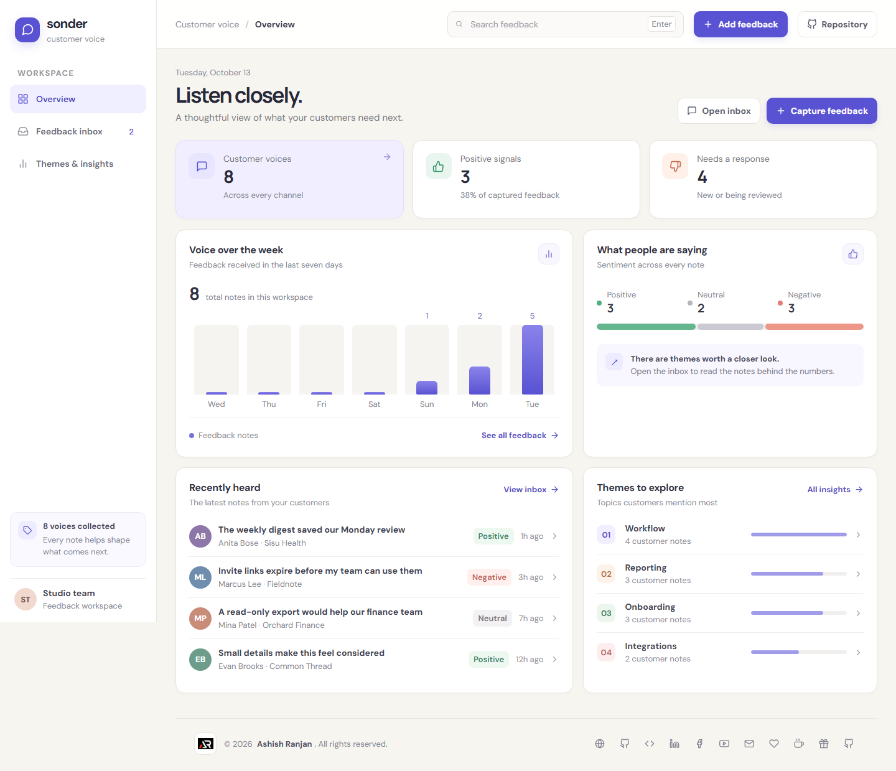
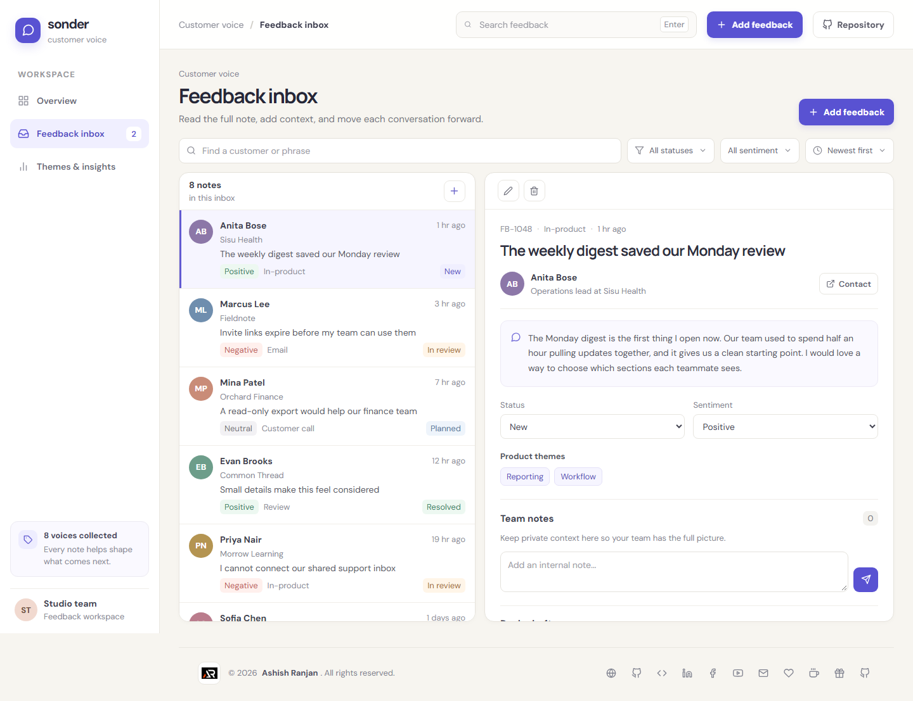
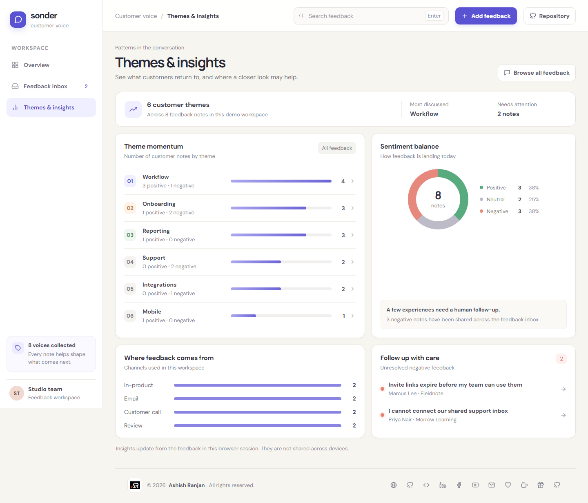
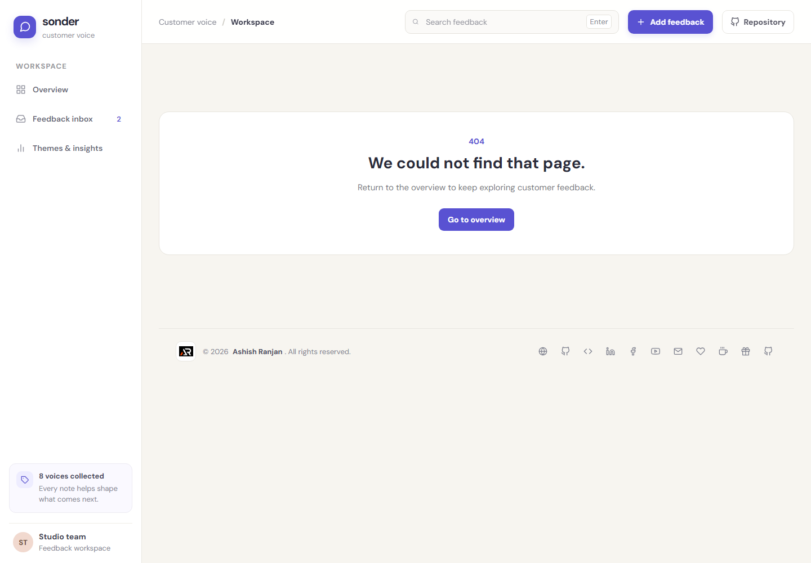
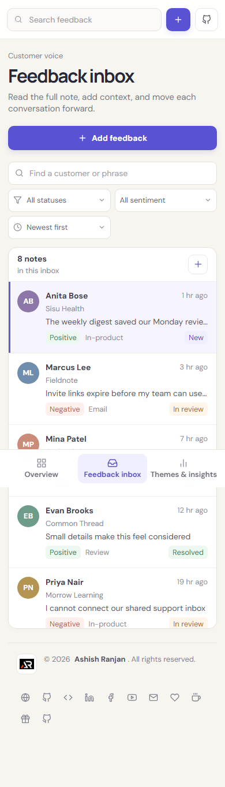
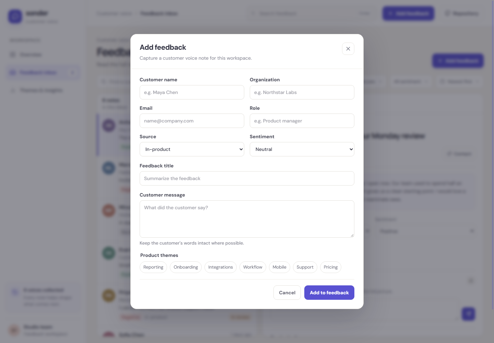
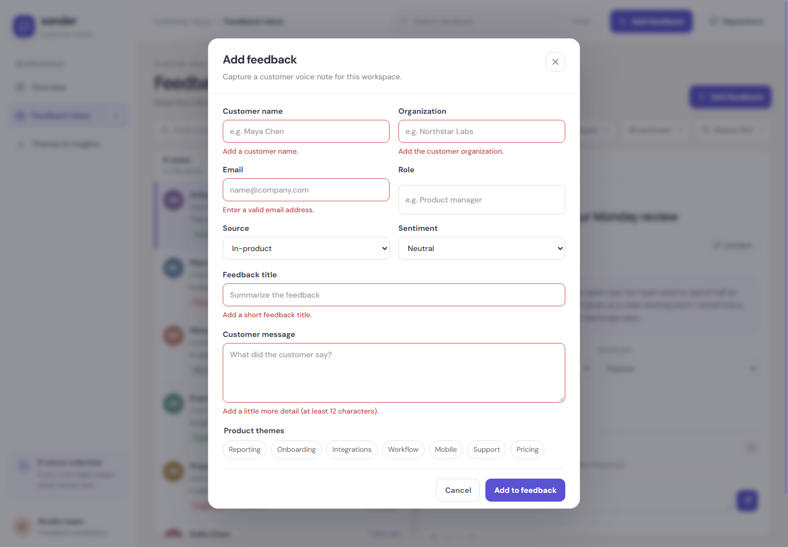
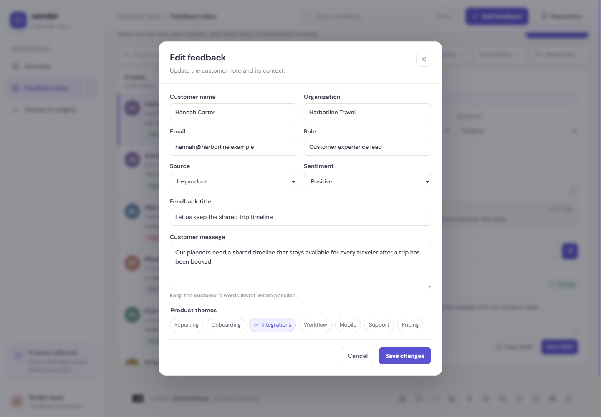
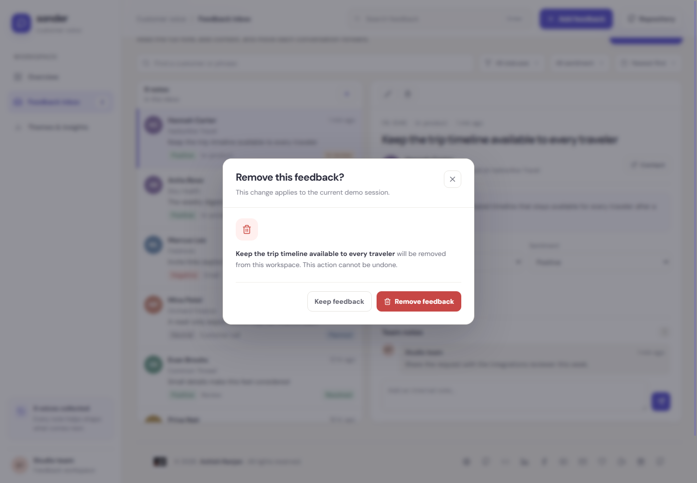

# Sonder | Customer Feedback

Sonder is a frontend-only customer feedback workspace for collecting customer notes, organizing follow-up, and spotting common product themes. It uses realistic sample records and keeps changes in React state while the app is open.

## Screenshots

Screenshots below were captured from the local production build with representative sample records.

### Pages

**Overview:** Live customer voice totals, weekly feedback activity, sentiment balance, recent notes, and the most mentioned themes.



**Feedback inbox:** Searchable split view with the selected customer message, team notes, status, sentiment, themes, and a reply draft.



**Themes and insights:** Feedback grouped by theme, sentiment distribution, source channels, and unresolved negative signals.



**Not found:** App-level fallback for an unknown route.



**Mobile inbox:** Responsive feedback list at a 390-pixel viewport.



### Dialogs

**Add feedback:** Create a customer note, set its source and sentiment, and assign product themes.



**Form validation:** Required fields and invalid values receive inline guidance.



**Edit feedback:** Update a customer note and its assigned themes.



**Delete confirmation:** Removing a note requires a custom confirmation. Cancel keeps the record unchanged.



## What is included

- **Overview:** Summary counts, a seven-day activity chart, positive, neutral, and negative distribution, recent customer messages, and shortcuts to themes and inbox records.
- **Feedback inbox:** Search by customer, organization, title, message, channel, or theme. Filter by status or sentiment, sort by date, and inspect the full selected message.
- **Customer records:** Add and edit the customer, organization, contact email, source, sentiment, title, message, and product themes. Form validation checks required fields and email format.
- **Follow-up workflow:** Move feedback through New, In review, Planned, and Resolved. Add internal team notes and write, save, or copy a reply draft.
- **Delete safety:** Deleting feedback opens a custom confirmation dialog. Confirm removes the record from the current session; cancel leaves it unchanged.
- **Themes and insights:** Counts and sentiment by theme, channel breakdown, and a short list of unresolved negative feedback. Selecting a theme opens the inbox with that theme filtered.
- **Responsive layout:** Persistent navigation on desktop, compact navigation at tablet sizes, and a list-to-detail flow on mobile.
- **Feedback:** Actions show toast messages. Dialogs close with Escape, the close button, or the backdrop.

## Frontend demo limits

This project has no backend, authentication, live integrations, or server storage. Sample data and all changes live only in the current browser session as React state. Refreshing the page restores the original sample records. Reply drafts stay in the app until refresh; copying a draft uses the browser clipboard. The app does not send email, sync customer channels, or share changes across users or devices.

## Run locally

Requires Node.js and npm.

```sh
npm install
npm run dev
```

The app uses React, Vite, React Router, React Icons, OverlayScrollbars, and `react-tooltip`.

## Checks

```sh
npm run lint
npm run build
```

## Deploy

The deployment command builds the app, copies the single-page entry to `dist/404.html`, and publishes `dist` to the repository's `gh-pages` branch:

```sh
npm run deploy
```

Live demo: [https://a2rp.github.io/customer-feedback-platform/](https://a2rp.github.io/customer-feedback-platform/)

## Future improvements

These are extensions that need shared services or external systems and are not implemented in this frontend demo:

- Add server-backed shared workspaces with user accounts, permissions, and durable feedback history.
- Connect feedback channels such as support inboxes, product surveys, and review providers through their APIs.
- Add team assignment, reminders, and notifications for feedback that needs a response.
- Store historical theme trends and audit changes on a server so reports remain available across sessions.

## Links

- Portfolio: [https://www.ashishranjan.net](https://www.ashishranjan.net)
- GitHub: [https://github.com/a2rp](https://github.com/a2rp)
- CodePen: [https://codepen.io/ash1198](https://codepen.io/ash1198)
- LinkedIn: [https://www.linkedin.com/in/aashishranjan](https://www.linkedin.com/in/aashishranjan)
- Facebook: [https://www.facebook.com/theash.ashish/](https://www.facebook.com/theash.ashish/)
- YouTube: [https://www.youtube.com/@ashishranjan-ashz?sub_confirmation=1](https://www.youtube.com/@ashishranjan-ashz?sub_confirmation=1)
- Email: [mailto:ash.ranjan09@gmail.com](mailto:ash.ranjan09@gmail.com)

## Support

- Support: [https://a2rp-donation-page.netlify.app/](https://a2rp-donation-page.netlify.app/)
- Buy Me a Coffee: [https://buymeacoffee.com/ashishranjan](https://buymeacoffee.com/ashishranjan)
- Patreon: [https://www.patreon.com/ashishranjan](https://www.patreon.com/ashishranjan)